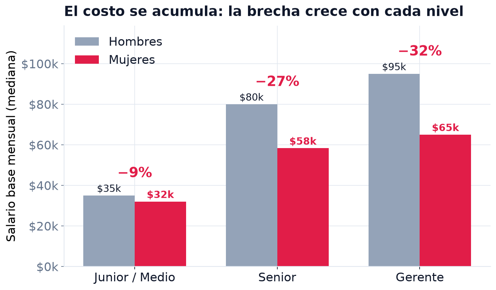
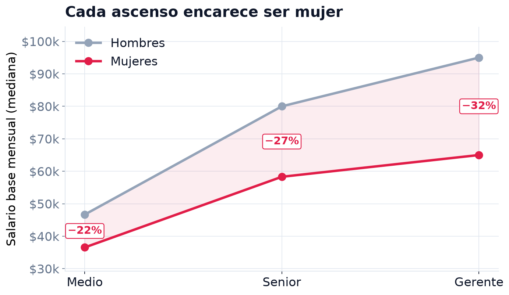
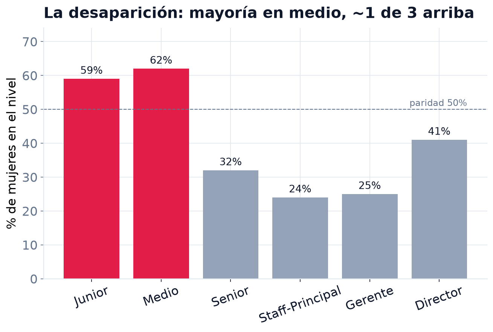
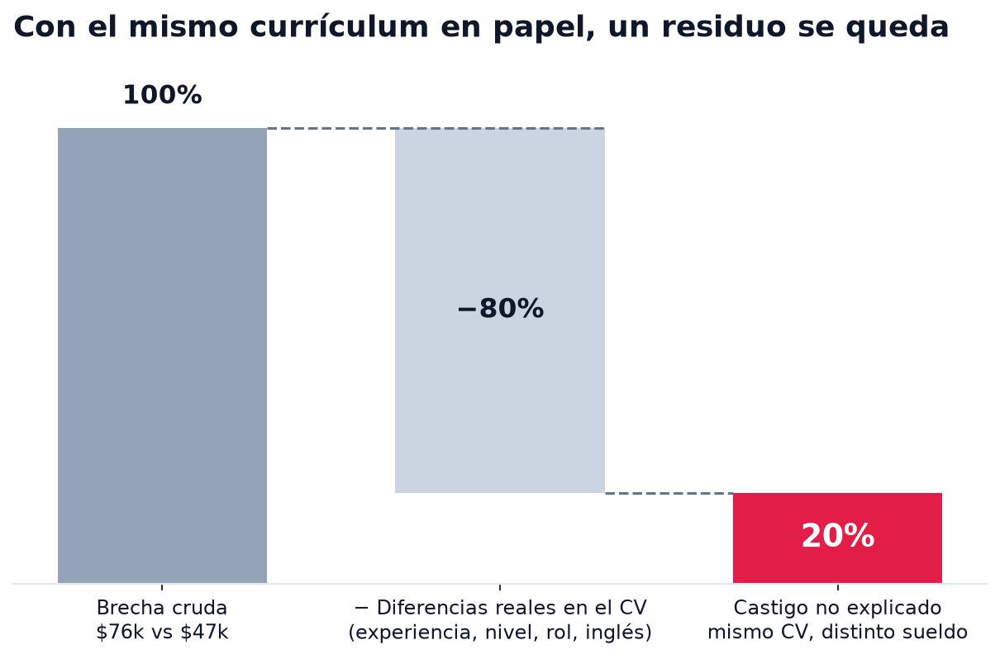
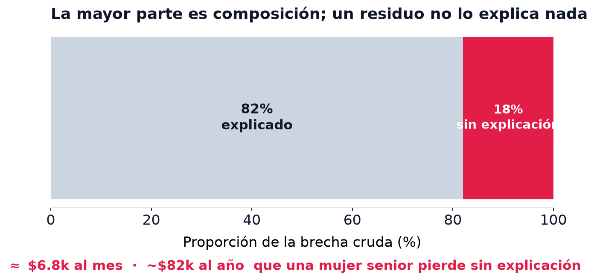
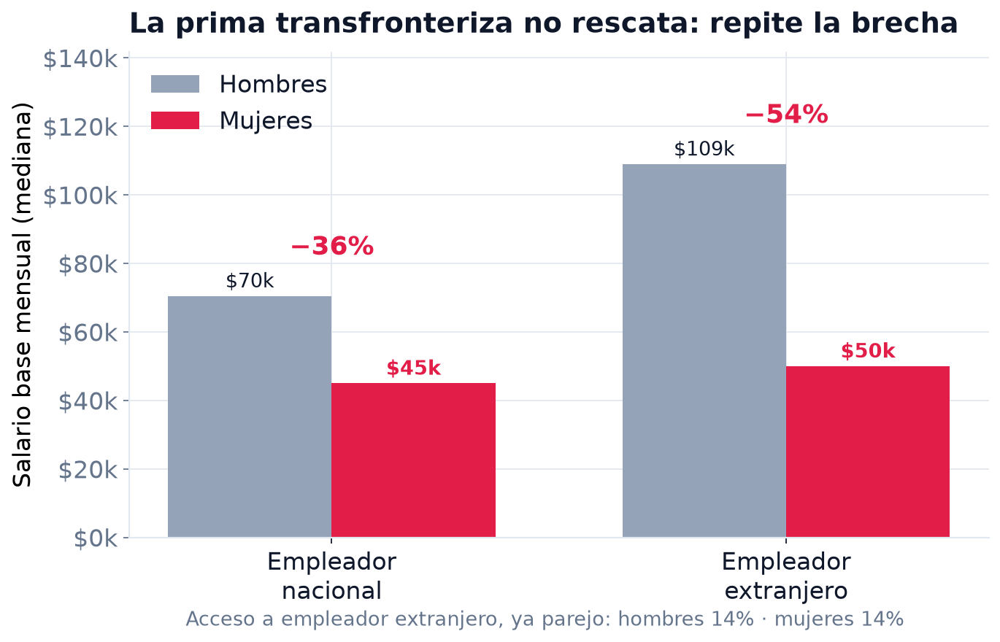
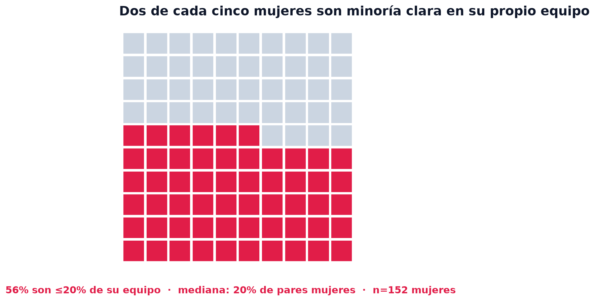
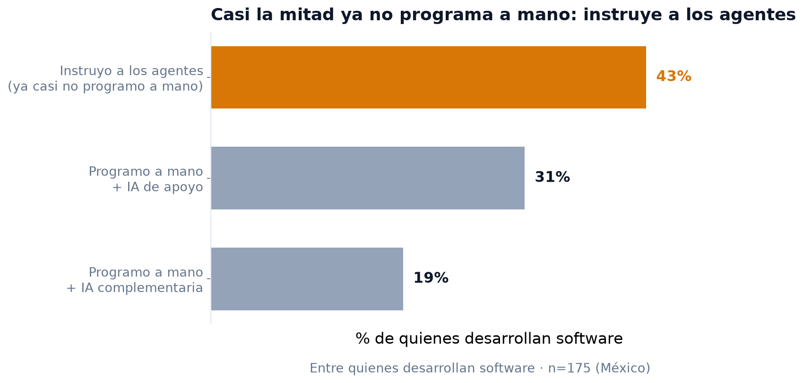

# La brecha de género en el tech mexicano

**SG Tech Pulse 2026 · hallazgos preliminares**

"En el tech mexicano, las mujeres son mayoría en el medio y se evaporan rumbo a la cima."

Solo México · n=500 (197 mujeres) · muestra autoseleccionada, cifras direccionales

---
layout: center
class: text-center
---

# El costo se acumula

Empieza desde temprano y crece con cada ascenso.

−38%

brecha cruda de salario base (mediana)

−9% → −32%

de junior/medio a gerente

~20%

de la brecha no la explica nada del trabajo

62% → 31%

mujeres, de nivel medio a senior+

---

# Hallazgo 1 — El costo se acumula

La brecha ya existe temprano (<b class="text-rose-600">−9%</b>) y crece con cada nivel hasta <b class="text-rose-600">−32%</b> en gerencia.

---

# Hallazgo 1 — Cada ascenso encarece ser mujer

Medio <b class="text-rose-600">−22%</b> → Senior <b class="text-rose-600">−27%</b> → Gerente <b class="text-rose-600">−32%</b>. Entre más alto, más cuesta.

---

# Hallazgo 2 — La desaparición

Mayoría en el nivel medio (<b>62%</b>), y apenas <b>~1 de cada 3</b> en senior o más. El conteo se adelgaza justo donde crece el castigo.

---

# Hallazgo 3 — Los pesos sin explicación

Emparejamos hombres y mujeres con el <b>mismo currículum en papel</b> (misma experiencia, nivel, rol e inglés): cuatro quintas partes de la brecha se explican por la composición, y <b>~12%</b> se queda sin explicación.

---
layout: center
---

# Hallazgo 3 — Y esa parte, en pesos

La parte que <b>nada del trabajo explica</b> se traduce en <b class="text-rose-600">~$7,700 al mes</b> (~$93,000 al año) para una mujer senior.

---

# Hallazgo 4 — La salida que no rescata

Ellas llegan al empleo extranjero a la <b>misma tasa</b> (13% vs 12%), pero ahí la brecha es <b class="text-rose-600">57%</b> ($115,000 ellos vs $50,000 ellas): el premio cruza-fronteras repite la brecha, no la cierra.
(direccional, n=27 mujeres)

---

# El aislamiento

La experiencia de las mujeres · sección solo-mujeres (n≈167)

<b class="text-rose-600">40%</b> de las mujeres son ≤20% de su equipo (mediana: 20% de pares mujeres). Son la excepción en su propia sala.

---
layout: center
class: text-center
---

# Qué significa

- **Mayoría en el medio, se evaporan rumbo a la cima.** Las mujeres son mayoría en el nivel medio pero apenas ~1 de cada 3 en senior o más, y en cada peldaño que sí suben se les paga menos. Los orígenes (edad al primer programa, acceso temprano a computadora) ya se emparejaron: es un problema de pago y progresión, no de entrada al pipeline. Un ~12% de la brecha no lo explican las cualificaciones.
- **Peticiones:** auditorías de equidad salarial en todos los niveles (no solo la cima); programas formales de mujeres hacia el liderazgo (63% reporta que no hay ninguno).

"En el tech mexicano, las mujeres son mayoría en el medio y se evaporan rumbo a la cima."

---

# Bonus — La IA ya cambió cómo se programa

Y paga: quienes trabajan así ganan una mediana de <b style="color:#d97706">$79,500</b> vs $58,000 (<b>+37%</b>). (descriptivo, no causal; n=174 · hilo aparte de la brecha)

¿Y las mujeres van en esta ola o se quedan atrás? <b>Se están quedando atrás:</b> entre quienes desarrollan software, <b>51% de los hombres</b> ya instruye a los agentes contra <b>32% de las mujeres</b> — y la brecha sobrevive al comparar el mismo rol. La ola agéntica arranca sesgada por género. <b class="text-rose-600">Responde SG Tech Pulse 2026.</b>

---
layout: center
class: text-sm
---

# Nota metodológica

Restringido a residentes en México (90% de la muestra). Salario base normalizado a MXN (USD × TC 18.5, robusto entre 17–20); log para regresión; outliers ~$8k–$400k recortados. Brecha cruda con IC bootstrap; descomposición Oaxaca-Blinder (controles: experiencia, seniority, inglés, familia de rol). Celdas con <5 mujeres suprimidas; personas no binarias (n=5) excluidas de la inferencia.

**Lo no explicado no equivale a discriminación probada:** también contiene factores no medidos, incluidos los ítems de mecanismo (negociación, patrocinio, promoción) eliminados del formulario desplegado. Muestra autoseleccionada y preliminar; el hallazgo 4 es direccional (n=27 mujeres).

Detalle completo: `docs/GENDER_FINDINGS_2026.md` / `_ES_MX.md`.
