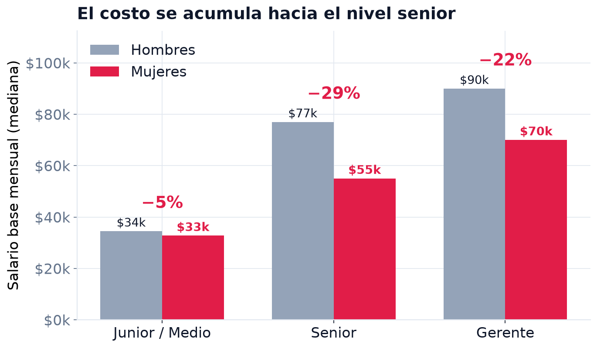
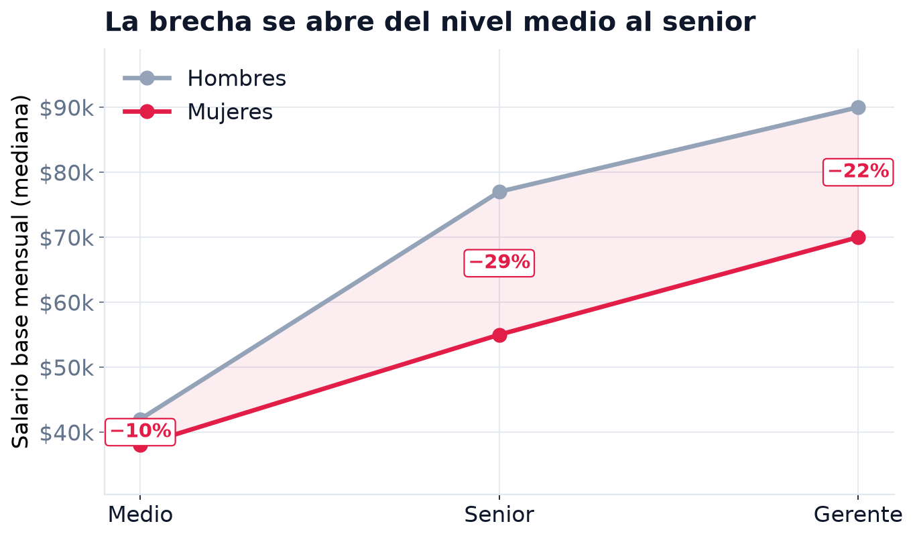
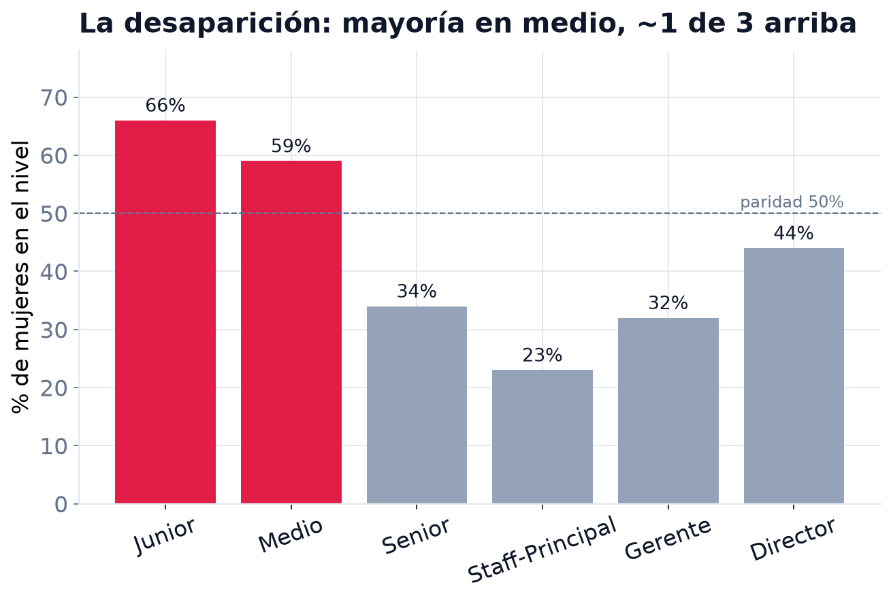
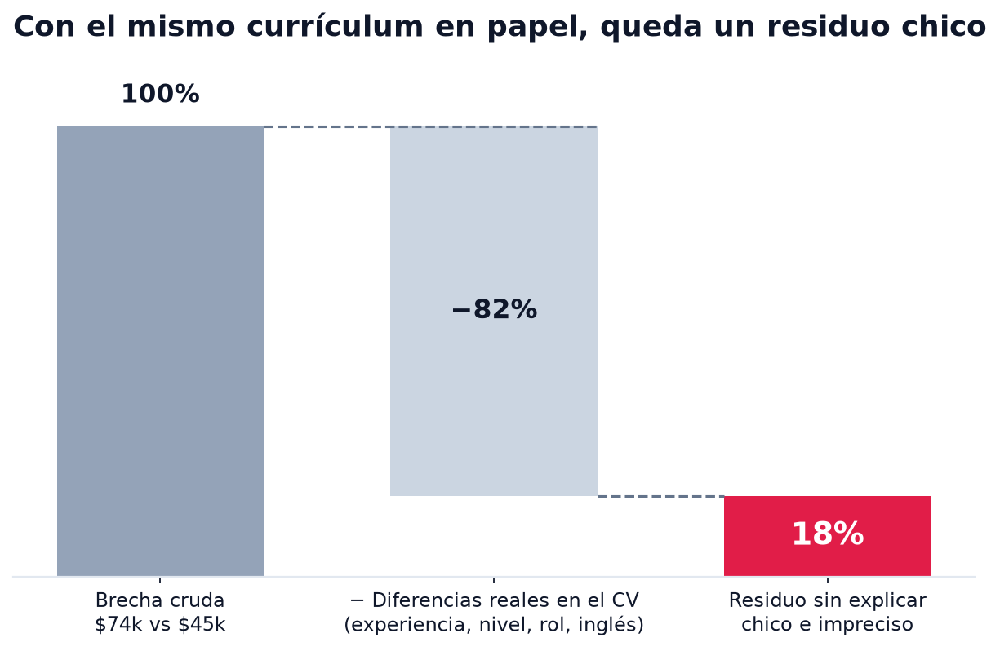
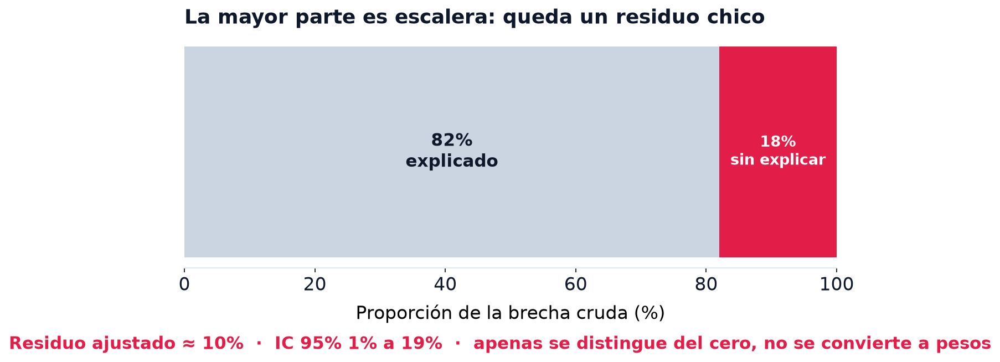
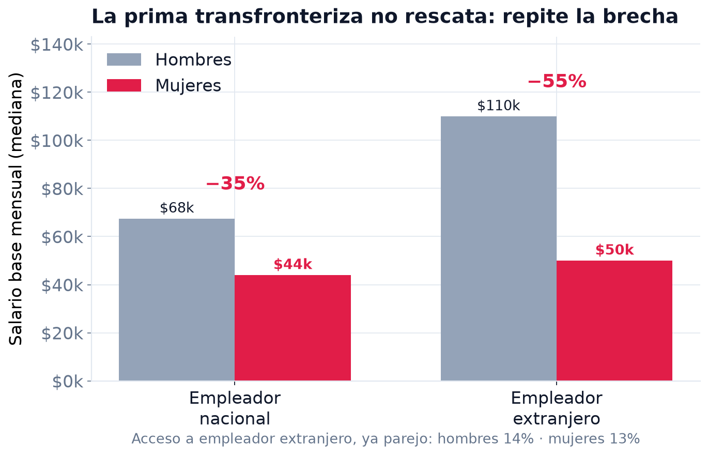
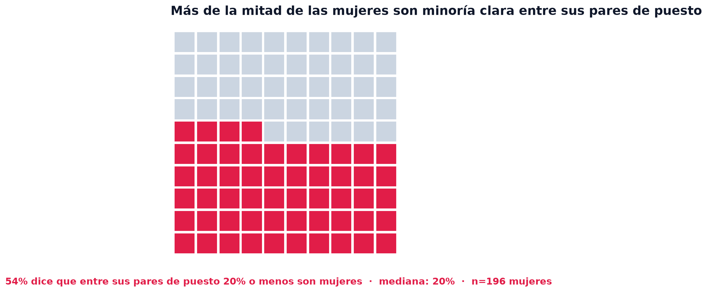
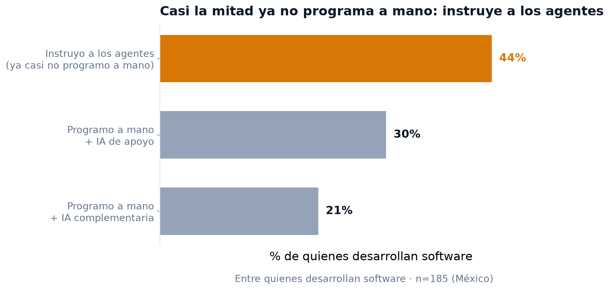

# La brecha de género en el tech mexicano

**SG Tech Pulse 2026 · hallazgos preliminares**

"En el tech mexicano, las mujeres son mayoría en el medio y se evaporan rumbo a la cima."

Solo México · 712 respuestas (287 mujeres) · n=642 con salario · muestra autoseleccionada, cifras direccionales

---
layout: center
class: text-center
---

# El costo pesa más arriba

La brecha empieza chica y se ensancha hacia el nivel senior.

−39%

brecha cruda de salario base (mediana: $73,900 ellos vs $45,000 ellas · IC 95%: 30% a 46%)

−5% → −28%

de junior y medio a senior o más

~10%

queda con el mismo perfil. Es chica e imprecisa (IC 95%: 1% a 19%). Cerca de 82% de la brecha es la escalera.

59% → 33%

mujeres, de nivel medio a senior o más

---

# Hallazgo 1: el costo pesa más arriba

En junior y medio la brecha es chica (<b class="text-rose-600">−5%</b>). En senior sube a <b class="text-rose-600">−29%</b> y en gerente queda en <b class="text-rose-600">−22%</b>.

---

# Hallazgo 1: la brecha se ensancha hacia el nivel senior

Medio <b class="text-rose-600">−10%</b> → Senior <b class="text-rose-600">−29%</b> → Gerente <b class="text-rose-600">−22%</b>. Del nivel medio a senior la brecha casi se triplica.
(gerente: solo 22 mujeres, cifra direccional)

---

# Hallazgo 2: la desaparición

Son mayoría en junior (<b>66%</b>) y en el nivel medio (<b>59%</b>). En senior o más son apenas <b>una de cada tres</b> (33%). El conteo se adelgaza justo donde la brecha se ensancha.

---

# Hallazgo 3: la mayor parte es la escalera

Emparejamos hombres y mujeres con el <b>mismo currículum en papel</b> (misma experiencia, inglés, nivel y rol). Cerca de <b>82%</b> de la brecha se explica por composición, sobre todo nivel y rol. El 18% restante queda sin explicar con estas variables.

---
layout: center
---

# Hallazgo 3: con el mismo perfil queda cerca de 10%

Al emparejar experiencia, inglés, nivel y rol, la brecha cae de 39% a cerca de <b class="text-rose-600">10%</b>. Ese ~10% ya se distingue del cero, aunque por poco: <b>IC 95% de 1% a 19%</b> (p≈0.035).

La estimación es la misma que en octubre. Lo que cambió es la precisión, porque hay más respuestas. Sí existe una multa por el mismo perfil, pero es chica e imprecisa, así que no la convertimos en pesos. La parte grande y firme de la brecha sigue siendo la escalera.

---

# Hallazgo 4: la salida que no rescata

Ellas llegan al empleo extranjero casi a la <b>misma tasa</b> (13% ellas vs 14% ellos, entre quienes respondieron). Ahí la brecha es <b class="text-rose-600">55%</b> ($110,000 ellos vs $50,000 ellas). El premio transfronterizo repite la brecha, no la cierra.
(direccional, n=32 mujeres)

---

# El aislamiento

La experiencia de las mujeres · sección solo para mujeres

<b class="text-rose-600">54%</b> de las mujeres dice que, entre sus pares de puesto, 20% o menos son mujeres (mediana: 20%, n=196). Son la excepción en su propia sala.

Una de cada cuatro (25%) se siente insegura o ha sufrido acoso en su empresa actual (n=217). 65% dice que su empresa no tiene un programa formal para llevar mujeres al liderazgo (n=220).

---
layout: center
class: text-center
---

# Qué significa

- **Mayoría en el medio, se evaporan rumbo a la cima.** Las mujeres son mayoría en el nivel medio, pero apenas una de cada tres en senior o más. Ahí la brecha llega a −28%. Los orígenes ya están parejos (edad al primer programa, acceso temprano a computadora). Es un problema de pago y progresión, no de entrada al pipeline.
- **La parte grande es la escalera.** Cerca de 82% de la brecha se explica por composición, sobre todo nivel y rol. Con el mismo perfil queda cerca de 10%. Sí existe una multa por el mismo perfil, pero es chica e imprecisa.
- **Peticiones:**
  - Auditorías de equidad salarial en todos los niveles, no solo en la cima.
  - Programas formales para llevar mujeres al liderazgo. El 65% dice que su empresa no tiene ninguno.

"En el tech mexicano, las mujeres son mayoría en el medio y se evaporan rumbo a la cima."

---

# Bonus: la IA ya cambió cómo se programa

Trabajar así se asocia con mejor sueldo. Quienes instruyen a los agentes ganan una mediana de <b style="color:#d97706">$77,500</b> vs $58,000 (<b>+34%</b>). Dentro del nivel senior la diferencia es +18% ($80,000 vs $68,000). (descriptivo, no causal · hilo aparte de la brecha)

¿Las mujeres van en esta ola o se quedan atrás? Entre quienes desarrollan software, <b>la mitad de los hombres</b> ya instruye a los agentes, contra <b>35% de las mujeres</b>. Es una señal que vigilar, no una conclusión: con solo 43 mujeres desarrolladoras en la muestra, la diferencia todavía no es estadísticamente concluyente. <b class="text-rose-600">Más respuestas lo van a aclarar. Responde SG Tech Pulse 2026.</b>

---
layout: center
class: text-xs
---

# Nota metodológica

- Solo residentes en México (90% de la muestra). Corte del 19 de noviembre de 2026: 712 respuestas de México, 642 con salario.
- Salario base normalizado a MXN (USD × TC 18.5). Log para la regresión. Se recortan los outliers fuera de ~$8k–$400k.
- Brecha cruda con IC bootstrap. Descomposición Oaxaca-Blinder con controles de experiencia, seniority, inglés y familia de rol.
- Los porcentajes se calculan sobre quienes respondieron cada pregunta.
- Celdas con menos de 5 mujeres suprimidas. Personas no binarias (n=5) excluidas de la inferencia.
- **Brecha ajustada:** 10.2% (n=636), IC 95% (HC3) de 0.7% a 18.7%, p=0.035. El bootstrap con 5 semillas también excluye el cero (límite inferior de 0.7% a 1.4%). Es robusta al tipo de cambio (10% con TC de 17, 18.5 y 20). Las cotas van de ~10% a 39%. Es chica e imprecisa, así que no se convierte a montos. Controlar por nivel y rol probablemente la subestima, porque esas variables pueden cargar el mismo sesgo.
- **Lo no explicado no equivale a discriminación probada.** También contiene factores no medidos, incluidos los ítems de mecanismo (negociación, patrocinio, promoción) eliminados del formulario desplegado.
- Muestra autoseleccionada y preliminar. El hallazgo 4 es direccional (n=32 mujeres), igual que el nivel gerente (22 mujeres). La diferencia de género en el uso de agentes no es estadísticamente significativa (Fisher p=0.114, 43 mujeres desarrolladoras).

Detalle completo: `docs/GENDER_FINDINGS_2026.md` / `_ES_MX.md`.
